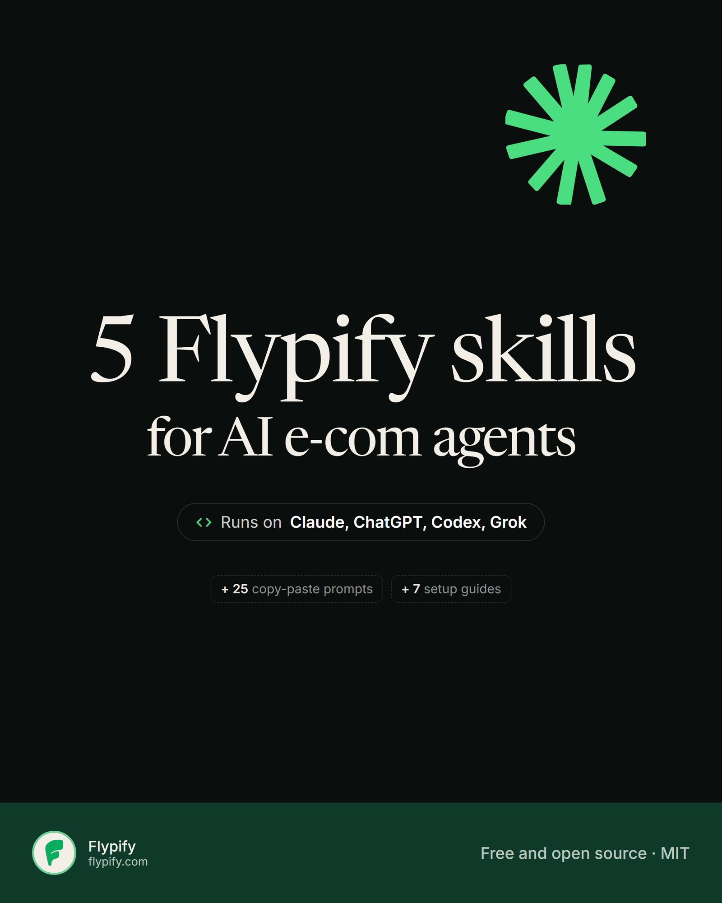
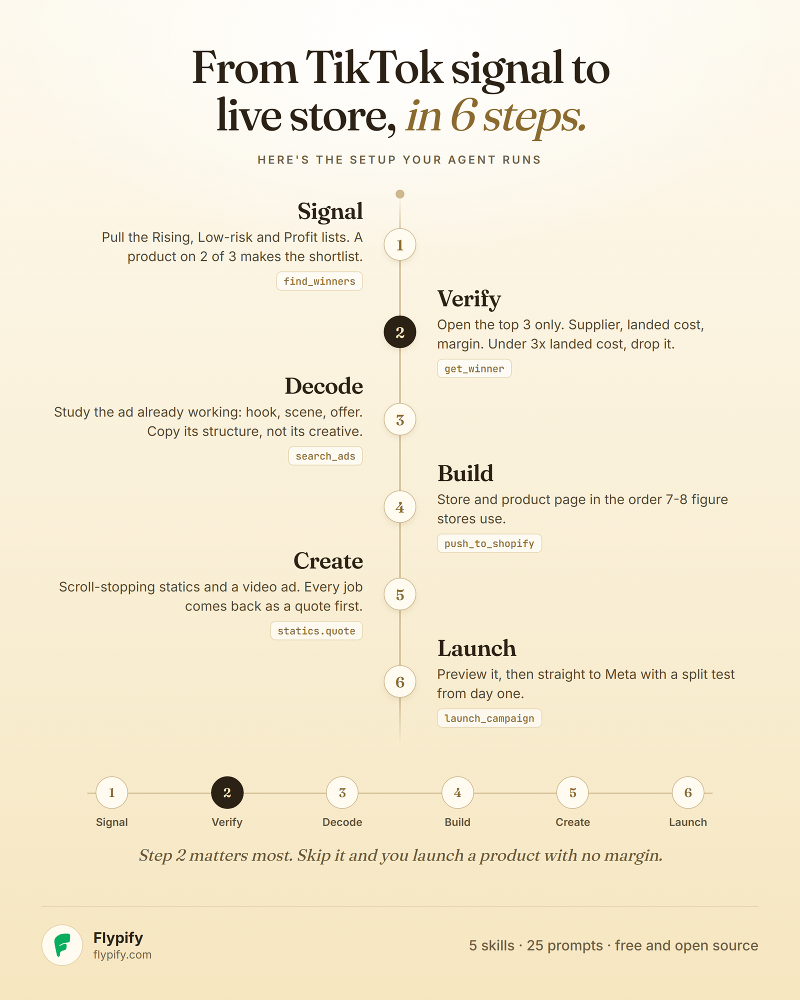
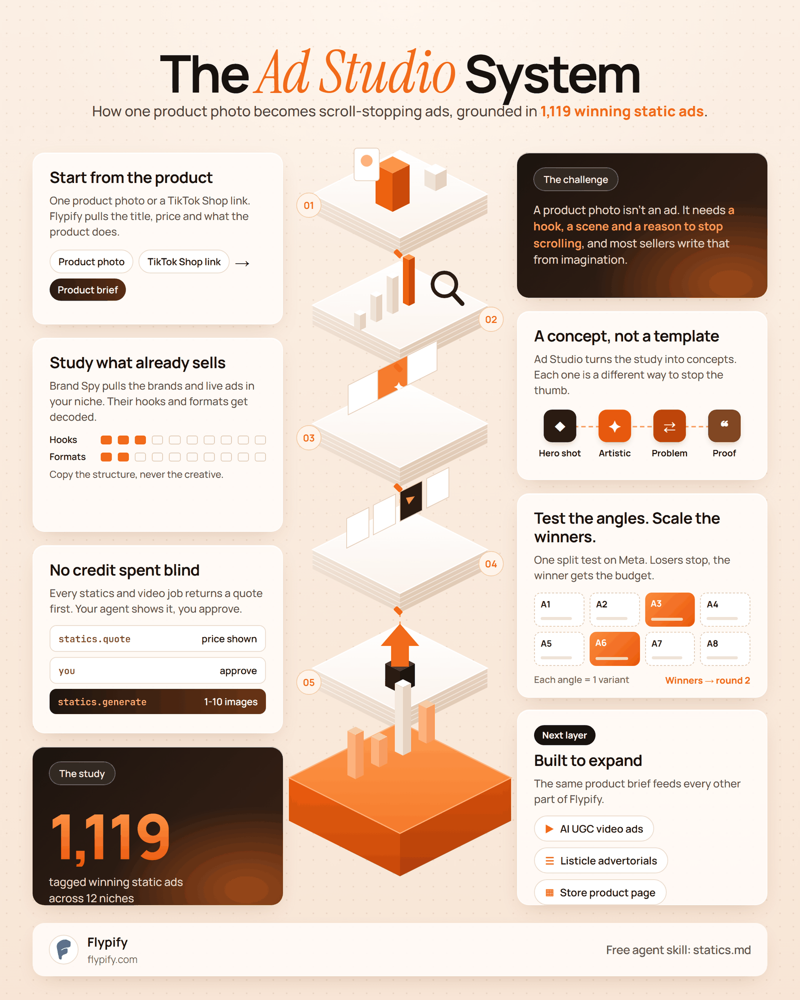
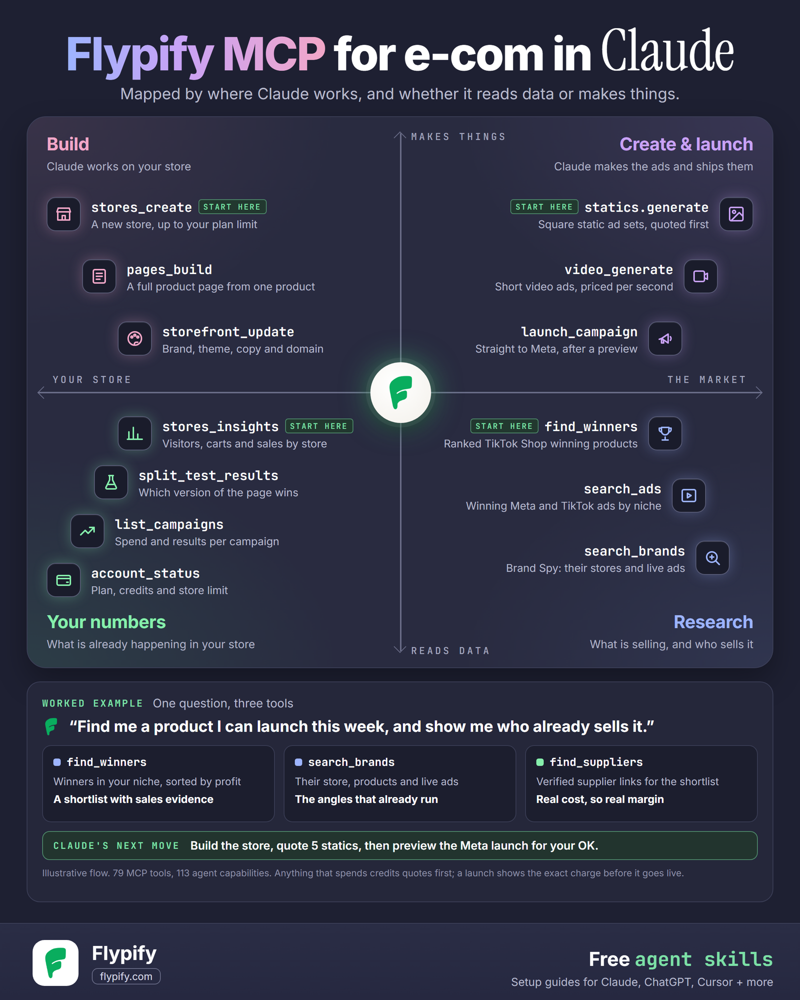

# Flypify Agent Skills

Turn any AI agent into an e-com operator: winners → supplier → store → listicle → static ads → Meta campaign, with one Flypify key.

[](docs/images/flypify-five-agent-skills.png)

Give your agent a Flypify API key and this repo, and it can run a launch end to end: find a product already selling on TikTok Shop, verify its supplier and winning ads, build a store page structured like the top one-product DTC stores, write the pre-sell listicle, brief scroll-stopping static ads and set up a Meta campaign. It runs in Claude Code, Codex and Cursor out of the box, and on ChatGPT, Grok, Perplexity, Muse or your own script with the guides in [`setup/`](setup/). It builds as many stores as your plan allows (Starter 5, Growth 35, Scale 100).

**→ [Start a plan at flypify.com/pricing](https://flypify.com/pricing)**

## Watch the walkthrough

<!-- VIDEO: add the walkthrough link here, e.g. [](https://youtu.be/VIDEO_ID) -->

## One-shot setup

Paste this repo's URL into Claude Code, Codex or Cursor and say:

> help me set this up

The agent clones the repo, runs the setup script (you paste your key into a hidden prompt, never into chat) and checks the connection. Or follow the five minutes below yourself.

## Prerequisites

| You need | Why |
|---|---|
| A Flypify plan ([pricing](https://flypify.com/pricing)) | the key only works on a paid plan |
| A Flypify API key | create it at flypify.com/account → "AI agent access (MCP)". It starts with `flypify_live_` |
| An agent | Claude Code, Codex or Cursor for this repo as is; other clients via [`setup/`](setup/) |
| `git`, `bash` and `curl` | macOS and Linux have them; on Windows, Git for Windows ships all three (or use the PowerShell scripts) |
| Optional: `jq` or Python 3 | setup uses either to print your plan and store count |

Nothing to `pip install` or `npm install`: the skills are Markdown and the agent does the calling.

## Get started (5 minutes)

### 1. Clone this repo

```bash
git clone <this repo's URL> flypify-agent-skills
cd flypify-agent-skills
```

### 2. Run setup

macOS, Linux or Git Bash:

```bash
./scripts/setup.sh
```

Windows PowerShell:

```powershell
powershell -ExecutionPolicy Bypass -File scripts\setup.ps1
```

This will:

- ask for your **Flypify API key** with hidden input and check it starts with `flypify_live_`
- verify it with Flypify (free calls, no credits or reveals) and print your plan and store count
- save it to `.env` as `FLYPIFY_API_KEY=...` (git-ignored, owner-only)
- create your personal `MASTER_CONTEXT.md` workspace file
- copy the skills into `.claude/skills/` and `.cursor/skills/`
- ask whether you want a single agent or an agent team (`--team` / `--single` to skip the question)

### 3. Open it in your agent

**Claude Code.** The `flypify` MCP server is already declared in [`.mcp.json`](.mcp.json). It reads `${FLYPIFY_API_KEY:-}` from your **shell environment**, not from `.env`, so load the key before you start. If the variable isn't set, the server still loads but every call answers 401:

```bash
set -a; . ./.env; set +a; claude
```

On first start Claude Code asks you to approve the project's MCP server. Run `/mcp` and check `flypify` is connected. A `SessionStart` hook prints a banner with the installed skills, whether your key and `MASTER_CONTEXT.md` are in place, and whether the repo has updates.

**Codex.** Export the key the same way, then add the server once:

```bash
codex mcp add flypify --url https://api.flypify.com/mcp/ --bearer-token-env-var FLYPIFY_API_KEY
```

Codex reads [`AGENTS.md`](AGENTS.md), which points it at the skill.

**Cursor.** Start Cursor from a shell where `FLYPIFY_API_KEY` is exported. [`.cursor/mcp.json`](.cursor/mcp.json) declares the server and [`.cursor/rules/project-context.mdc`](.cursor/rules/project-context.mdc) points the agent at the skill.

### 4. Single agent or agent team

The first time your agent connects, it asks how you want to run Flypify:

- **Single agent:** one agent runs the whole launch loop. Simplest.
- **Agent team:** a lead agent plus 10 specialists, each one owning a part of Flypify's capabilities and data. Best for several stores or a weekly cadence.

[](docs/images/flypify-agent-team.png)

| Specialist | What it owns |
|---|---|
| Winners Research | daily picks, TikTok Shop sales, trend check, sales evidence |
| Brand Spy & Ad Library | brand search, winning ad finder, hook spotter, format tags |
| Supplier Sourcing | supplier match, AliExpress search, link verifier, margin math |
| Store Builder | store create, theme picker, product pages, domain connect |
| Listicles & Advertorials | angle ideas, advertorial draft, image swap, publish |
| Static Ad Studio | concept brief, product hero shot, price quote, render batch |
| Video Ad Studio | format picker, hook and script, clip quote, render check |
| Meta Campaigns | pixel check, audience reach, launch preview, launch to Meta |
| Split Tests & Variants | variant builder, price tests (judged on revenue per visitor), results reader, winner picker |
| Store Insights | sales reader, traffic check, page revisions, webhook alerts |

In Claude Code, Codex or Cursor, `./scripts/team.sh` (PowerShell `scripts	eam.ps1`) installs them: Claude Code gets ten `flypify-*` subagents, Codex and Cursor get them as skills. In ChatGPT, Grok, Claude.ai, Perplexity or Muse each specialist becomes its own project or agent: [`setup/agent-team.md`](setup/agent-team.md). The lead hands work out, passes short handoffs between specialists, and is the only one that asks you for a yes. `./scripts/team.sh --remove` goes back to one agent.

### 5. Start

> Use Flypify. Check my account and stores, then find 5 winners in {your niche} and tell me which one to launch.

The agent handles the calls, polling, retries and error codes, and quotes every spend before it makes it. Workflows below are grouped by what you want to make. All 25 prompts are in [`prompts/PROMPT-PACK.md`](prompts/PROMPT-PACK.md).

[](docs/images/flypify-signal-to-store-6-steps.png)

---

### Find winners

> Use Flypify. In {niche}, pull winners sorted Rising, LowRisk and Profit (10 each). Show me the 5 that appear on two lists or score best on revenue, saturation under 40%, 30-180 days running and a forecast low line above zero. One line each on why. Don't reveal any yet.

> Use Flypify. Reveal {opp_id_1}, {opp_id_2}, {opp_id_3}. For each: supplier link, landed cost, suggested price at 3x, margin, forecast band, and the winning TikToks. Drop any without both a verified supplier and a winning ad. Recommend one.

Shortlist wide, go deep only on finalists, and never build without a verified supplier and a winning ad. See [`skills/flypify/SKILL.md`](skills/flypify/SKILL.md) steps 1-2.

### Spy on a brand

> Use Flypify Brand Spy. Find the top 3 rising brands in {niche} over 30 days. For the strongest, pull its live ads and landing page and fill the brand card from brand-spy.md. Then give me the angle they are NOT using and a plan to own it.

> Use Flypify. Look up the brand {brand name}. What do they sell, at what price ladder, what do they promise above the fold, which ad formats do they scale, and what doubt does their page leave unanswered?

Model the structure, never the footage, name or words. See [`skills/flypify/brand-spy.md`](skills/flypify/brand-spy.md).

### Build a store

> Use Flypify. Push winner {opp_id} to my Shopify as a draft with a buyer-facing title (outcome + who it's for) and price {price}. Then give me the product description and the 15-section page plan from stores.md to paste in.

> Use Flypify. Read the page for row {row_id}. Score it against the 20-point critic in stores.md, then propose fixes as a dry run: new H1, 3 bullets, headings as claims, problem section, comparison against the old way, FAQ from real review objections. Show me the diff before writing.

Section order, copy formulas and field limits, gallery and trust stack, offer ladder, and a 20-point pre-publish critic. See [`skills/flypify/stores.md`](skills/flypify/stores.md).

### Write a listicle

> Use Flypify. Suggest article ideas for row {row_id}, pick the best switching angle with 7 reasons, quote it, and after my yes write it. Then tighten it with listicles.md: headings as claims, one real review quote, a cost comparison, a fit check. Show it before publishing.

> Use Flypify. Row {row_id} sells at ${price}. Write a story-first article using the "How {audience} are {outcome} without {disliked fix}" headline: problem and failed fixes first, product no earlier than reason 3, guarantee last.

When to pre-sell, 8 headline formulas, reason-by-reason structure, image direction and a 10-point article critic. See [`skills/flypify/listicles.md`](skills/flypify/listicles.md).

### Make static ads

> Use Flypify. Make 6 static ads for {product}. Pick the best product photo, write 6-8 selling points as the buyer would say them (outcome first, the old way it replaces, one real offer line if I'm running one: {offer or none}), quote, wait for my yes, generate, and score every image with the statics.md rubric before showing me the keepers.

> Use Flypify. My best static says "{winning headline}". Make 3 more that keep its promise but change the scene and layout, then turn the line into a page H1 split test and a 6-second video hook.

What 1,119 winning statics have in common, how to pick the hero photo, 10 archetypes, how many to make and a scoring rubric. See [`skills/flypify/statics.md`](skills/flypify/statics.md).

[](docs/images/flypify-ad-studio-system.png)

### Make video ads

> Use Flypify. Write three 6-second hook clips for {product}, each one scene and one action with the real product photo as reference, 9:16. Quote the cheapest model for all three, wait for my yes, generate and send me the links.

Statics first for cheap angle tests, then 2-3 short video hooks for the angle that wins. See [`skills/flypify/SKILL.md`](skills/flypify/SKILL.md) step 6.

### Launch & split-test

> Use Flypify. Check my ad account setup and pixel for {store url}. Draft a test campaign for {product} with {statics or video}, ${daily budget}/day, {countries}. Show me the launch preview with the exact charge. Do not launch until I say "launch".

> Use Flypify. On row {row_id}, read the split-test history first, then start a test on the store hero with 2 challenger headlines built from my best ad angles. Dry run first and send me the preview links.

The draft spends nothing; the launch preview shows the exact charge before anything goes live. See [`skills/flypify/SKILL.md`](skills/flypify/SKILL.md) step 7.

### Run 5 stores in parallel

> Use Flypify. Check how many stores my plan has left. Pick {5} different store-ready winners in {niches}, one per store, never the same product twice. Give me one table of every credit cost across all five, wait for my yes, then build each store with its own store id and keep a ledger (store, product, row, page, listicle, statics jobs).

One winner per store, one table of quotes for one yes, a ledger in every reply. See [`skills/flypify/SKILL.md`](skills/flypify/SKILL.md) section 5 and [`docs/how-it-works.md`](docs/how-it-works.md).

---

## What's in the box

| Path | What it does |
|---|---|
| `skills/flypify/SKILL.md` | **The core skill.** The 8-step launch loop, plan limits, money rules, polling, idempotency, full error playbook. |
| `skills/flypify/stores.md` | 7-8 figure store blueprint: section order, copy formulas and field limits, gallery and trust stack, offer ladder, 20-point pre-publish critic. |
| `skills/flypify/listicles.md` | When to pre-sell, 8 headline formulas, reason-by-reason structure, image direction, 10-point article critic. |
| `skills/flypify/statics.md` | What 1,119 winning statics have in common, the hero photo, selling points that become headlines, 10 archetypes, a scoring rubric. |
| `skills/flypify/brand-spy.md` | Reverse-engineer a competitor's angle, ads and page, then turn it into your own plan. |
| `skills/flypify/agent-team.md` | Agent team mode: the first-connection question, the roster, how the lead runs the team, the handoff format. |
| `team/` | The 10 specialist agents (one file each, usable as a Claude Code subagent or a skill). |
| `scripts/team.sh` / `team.ps1` | Installs the team (or `--remove` / `-Remove` to go back to one agent). |
| `prompts/PROMPT-PACK.md` | 25 copy-paste prompts from "find winners" to "five stores in parallel". |
| `setup/` | Connection guides: Claude Code, Claude.ai/Desktop, ChatGPT and Codex, Cursor, Grok, Perplexity, any HTTP or MCP client. |
| `.mcp.json` | Project-scoped Flypify MCP server for Claude Code (reads `FLYPIFY_API_KEY` from your environment). |
| `.cursor/mcp.json`, `.cursor/rules/` | The same server and a project rule for Cursor. |
| `AGENTS.md` / `CLAUDE.md` | Instructions Codex, Claude Code and other agents read on start. |
| `MASTER_CONTEXT.template.md` | Template for your workspace memory. |
| `MASTER_CONTEXT.md` | Your copy (created by setup, git-ignored). |
| `.env` | Your API key (created by setup, git-ignored). |
| `scripts/setup.sh` / `setup.ps1` | One-time setup: key, verification, memory file, skills. |
| `scripts/sync-skill.sh` / `.ps1` | Copies `skills/` to `.claude/skills/` and `.cursor/skills/`. |
| `scripts/check-context.sh` / `.ps1` | SessionStart banner, hooked into `.claude/settings.json`. |
| `logs/` | Per-call log of paid capabilities: capability, credits quoted, credits charged (`.jsonl` is git-ignored). |
| `references/` | Your product photos, brand files and notes (git-ignored). |
| `docs/how-it-works.md` | The launch loop as a diagram, and every point where the agent stops for you. |

[](docs/images/flypify-mcp-capability-map.png)

## What your plan lets the agent do

| | Starter | Growth | Scale |
|---|---|---|---|
| Price | $39/mo ($372/yr) | $99/mo ($948/yr) | $249/mo ($2,388/yr) |
| Stores | 5 | 35 | 100 |
| Product research, winning ads, Brand Spy, suppliers | yes | yes | yes |
| Push to Shopify as a draft | yes | yes | yes |
| Static and video ads (credits, quoted first) | yes | yes | yes |
| Agent builds Flypify stores, pages, listicles, split tests, campaign drafts | yes | yes | yes |
| Agent launches a campaign or lists a Whop product | in the app | in the app | yes |
| Product reveals a day | 150 | 150 | unlimited |
| Agent API calls a day | 2,000 | 2,000 | 20,000 |

Start a plan at [flypify.com/pricing](https://flypify.com/pricing). Credit-spending agent capabilities can be switched off for agents while they roll out; the agent then tells you to run that step in the Flypify app.

## Project memory

`MASTER_CONTEXT.md` is your workspace's living memory. The agent reads it at the start of every session and writes back what it learns, so you are not asked the same thing twice. It holds:

- **Account:** plan, stores allowed, Shopify connected
- **Defaults:** niche, target margin, price range, countries, daily test budget
- **Stores:** each store's id, niche, product, page row, domain and status
- **Brand voice:** buyer persona, tone, words to use and avoid, the offer you run
- **Credit spend learnings:** what statics, video, listicles and page builds actually cost on your account
- **Changelog:** a dated line for each session's work

## Your API key

You paste the key once, into the setup script's hidden prompt. It goes to `.env` and never into chat.

- Get a plan: **[flypify.com/pricing](https://flypify.com/pricing)**
- Create a key: flypify.com/account → "AI agent access (MCP)". It starts with `flypify_live_`.
- MCP URL: `https://api.flypify.com/mcp/` (keep the trailing slash). Header: `Authorization: Bearer flypify_live_...` (or `X-Flypify-Key: flypify_live_...`).
- `.mcp.json` uses `${FLYPIFY_API_KEY:-}`, which Claude Code expands from the environment it was started in (empty if unset). `.env` is not loaded automatically: run `set -a; . ./.env; set +a` first (PowerShell: the one-liner the setup script prints). **A 401 from the `flypify` server almost always means the key wasn't exported** in the shell that started your agent.
- Claude.ai, ChatGPT and Perplexity can sign in by URL (OAuth) instead of using a key: see [`setup/`](setup/).
- To replace a key: `./scripts/setup.sh --force` (PowerShell: `-Force`). Revoke old keys at flypify.com/account.

## Security

- `.env` and `MASTER_CONTEXT.md` are git-ignored, never committed. Setup restricts `.env` to your user.
- Never paste your key into chat, issues or screenshots. The agent never prints it.
- **Money rules the agent follows:**
  - It quotes every credit or ad spend, with the number, and waits for your yes.
  - Nothing goes live (products, articles, campaigns, split-test winners) without your yes in that conversation.
  - Launching a campaign from an agent needs the **Scale** plan. On Starter and Growth the agent builds the campaign draft and you launch it in the Flypify app.
  - It uses `dry_run` first where it exists and shows you the diff.
  - It never invents reviews, ratings, stats, experts or countdowns, and never copies another brand's name, photos or words.
- Every change the agent makes is logged as a revision and can be undone (`revisions_list`, `revisions_restore`). Paid calls are also logged locally in `logs/`.

## Staying current

- **At every Claude Code session start,** the `check-context.sh` hook runs `git fetch` with a 10-second ceiling (never blocks, never pulls). If you are behind, the banner says how many commits and tells you to run `git pull`.
- **To update by hand:** `git pull` from the repo root.
- **Your files survive updates:** `.env`, `MASTER_CONTEXT.md`, `references/`, `outputs/` and `logs/*.jsonl` are all git-ignored. If you customise a skill, keep your version under a path git doesn't track (e.g. `local-skills/`) to avoid merge conflicts.
- **Editing skills:** change `skills/flypify/`, then run `./scripts/sync-skill.sh` (it also runs at every Claude Code session start).

## Other agents (ChatGPT, Grok, Perplexity, Muse…)

| Client | Guide |
|---|---|
| Claude.ai and Claude Desktop (sign in by URL) | [`setup/claude-desktop-and-claude-ai.md`](setup/claude-desktop-and-claude-ai.md) |
| ChatGPT and Codex | [`setup/chatgpt-and-codex.md`](setup/chatgpt-and-codex.md) |
| Cursor | [`setup/cursor.md`](setup/cursor.md) |
| Grok (xAI API) | [`setup/grok.md`](setup/grok.md) |
| Perplexity | [`setup/perplexity.md`](setup/perplexity.md) |
| Muse, Windsurf, n8n, any MCP client, or plain HTTP | [`setup/generic-http.md`](setup/generic-http.md) |
| An agent team in any of the above | [`setup/agent-team.md`](setup/agent-team.md) |

Any other assistant: point it at [`AGENTS.md`](AGENTS.md), `MASTER_CONTEXT.md` and `skills/flypify/`.

## License

[MIT](LICENSE). The skills and scripts are free to use and adapt. A Flypify plan is needed for the agent to call Flypify. Flypify doesn't promise income; results vary and depend on you.
