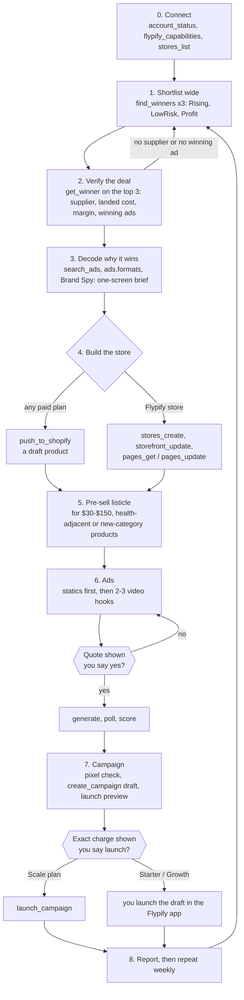

# How it works

Your agent talks to Flypify over one connection (MCP at `https://api.flypify.com/mcp/`, or the HTTP Agent API at `https://api.flypify.com/api/v1`), authenticated with your key. The skill in `skills/flypify/` tells it which agent capabilities to call, in what order, and where to stop and ask you.

## The launch loop

## Where the agent stops for you

| Moment | What you see | What happens without a yes |
|---|---|---|
| Static, video or listicle generation | the credit quote | nothing is generated |
| `pages.build` | "about 80 credits" | nothing is built |
| Publishing a product or listicle | the page or article | stays a draft |
| Campaign launch | the exact charge from the launch preview | stays a draft |
| Storefront, page or split-test edits | a `dry_run` diff | nothing is written |

Every change the agent makes is recorded as a revision (`revisions_list`) and can be put back (`revisions_restore`).

## Running several stores

Same loop, one winner per store, never the same product twice. The agent passes `store` on every call, adds up every quote across stores into one table for one yes, and keeps a ledger: store id, product, row, page, listicle, statics jobs, campaign. Up to 8 calls in flight per account; 4 stores side by side is the practical limit.
